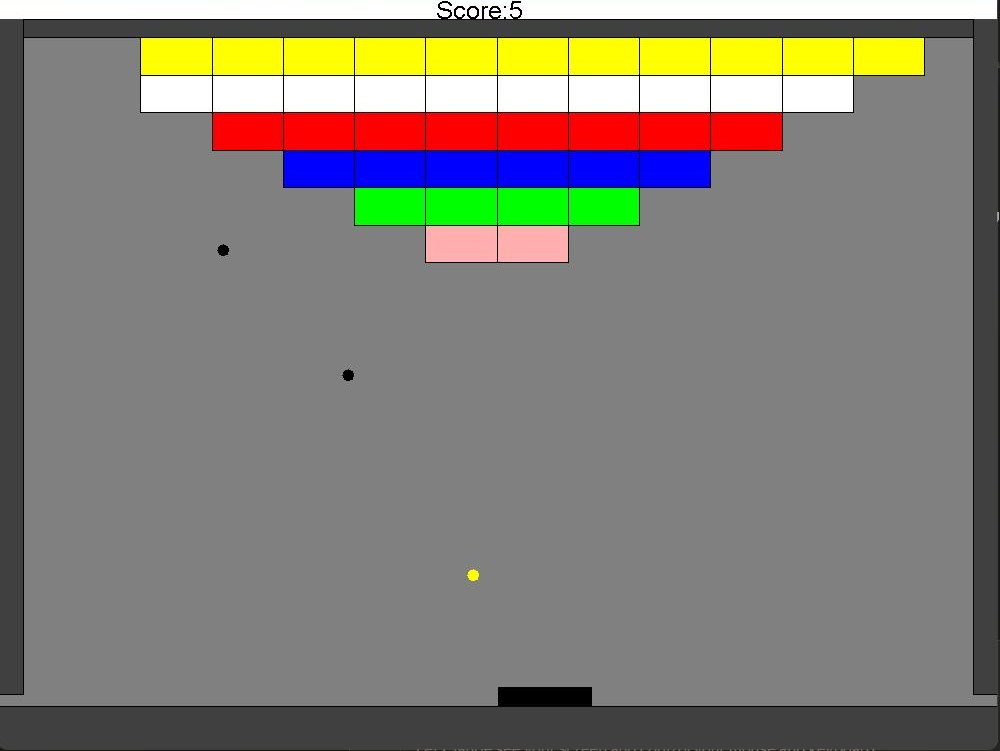
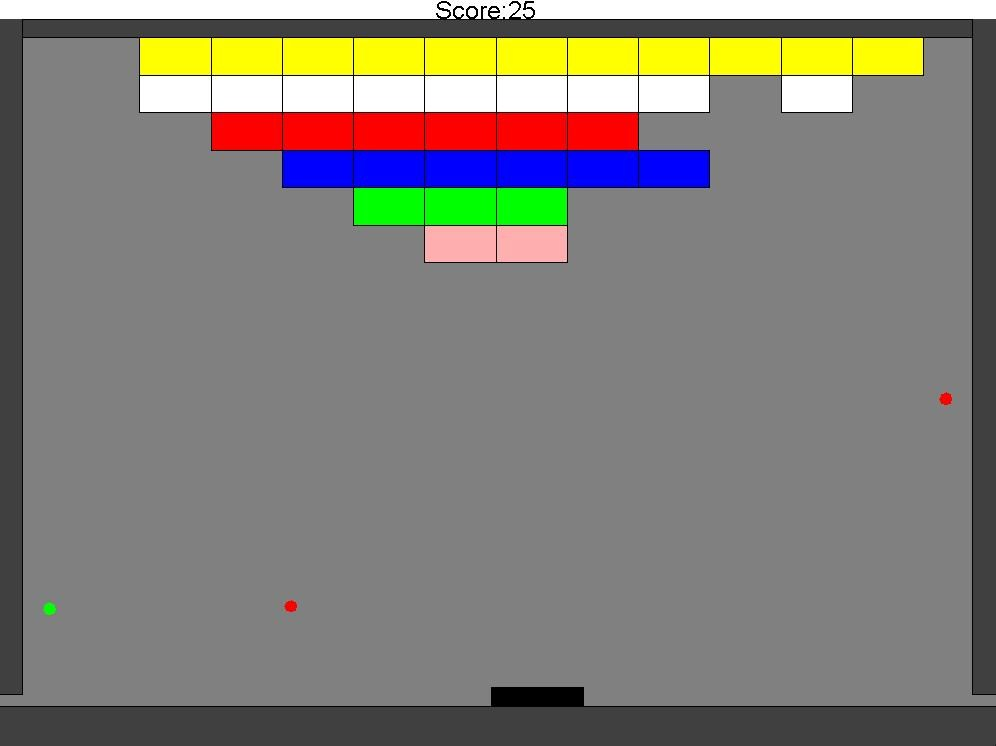

# Enhanced Arkanoid Game (Java)

A classic brick-breaker game built in Java with a strong focus on clean, object-oriented design.
Break all the blocks with the balls while keeping them in play with your paddle.



## Features

- Multiple balls in play at once, each with its own velocity
- Keyboard-controlled paddle with **5 hit regions** that change the bounce angle, so you can aim
- A pyramid of colored blocks that disappear when hit
- Live score indicator, with a bonus for clearing the level
- The game ends when all blocks are cleared or all balls are lost
- Smooth, fixed **60 FPS** game loop

## Design

The code is organized into packages with a single responsibility each:

| Package | Responsibility |
|---|---|
| `GameMain` | `Game` — builds the level and runs the 60 FPS animation loop |
| `Objects` | `Sprite` and `Collidable` interfaces; `Ball`, `Block`, `Paddle`, `SpriteCollection`, `GameEnvironment` |
| `GameUpdating` | Game rules as hit listeners: `BlockRemover`, `BallRemover`, `ScoreTrackingListener`, `ScoreIndicator` |
| `MovingAndMechanics` | `Velocity`, `CollisionInfo`, `Counter`, and the `HitNotifier` / `HitListener` interfaces |
| `GeometricPrimitives` | `Point`, `Line`, `Rectangle` — intersections and geometry |

**Patterns and techniques**

- **Interfaces over concrete types** — the game loop only knows about `Sprite` and `Collidable`, so new kinds of objects can be added without changing it.
- **Observer pattern** — blocks notify `HitListener`s when hit; removing blocks, removing balls and scoring are separate listeners rather than logic inside `Ball` or `Block`.
- **Continuous collision detection** — each frame, the ball's movement is a line segment; the closest intersection with any collidable is found and the ball is placed just before it, so fast balls never pass through blocks.
- **Safe iteration** — sprites and listeners are iterated over copies of their lists, so objects can remove themselves during a hit event.

## Screenshots

| Level start | Mid-game |
|---|---|
|  |  |

## Running the game

Requirements: **Java 8+** and **Apache Ant**. The `biuoop-1.4.jar` GUI library is included in the repo.

```bash
ant run
```

Other targets: `ant compile` builds the classes into `bin/`, and `ant clean` removes them.

**Controls:** ← / → arrow keys move the paddle.

## Author

**Yehonatan Abramovitch** — [Portfolio](https://yehonatanabramovitch.github.io) · [LinkedIn](https://www.linkedin.com/in/yehonatan-abramovitch)
